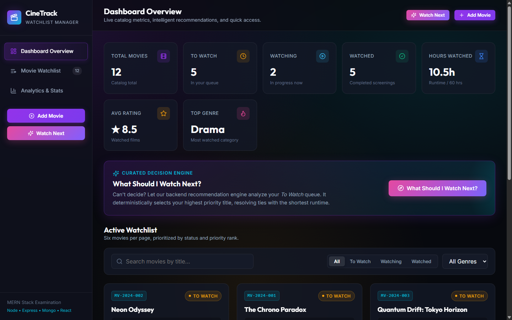
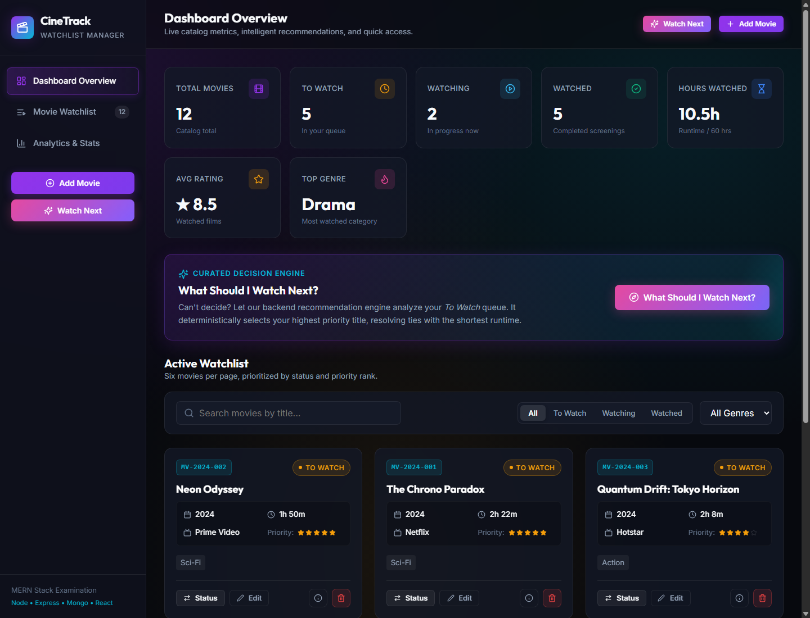
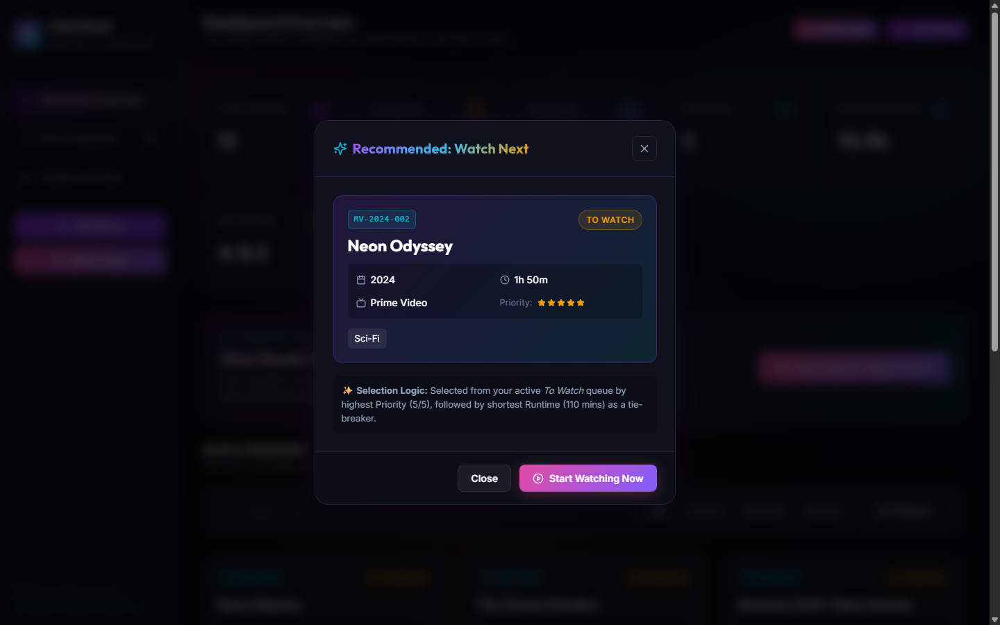
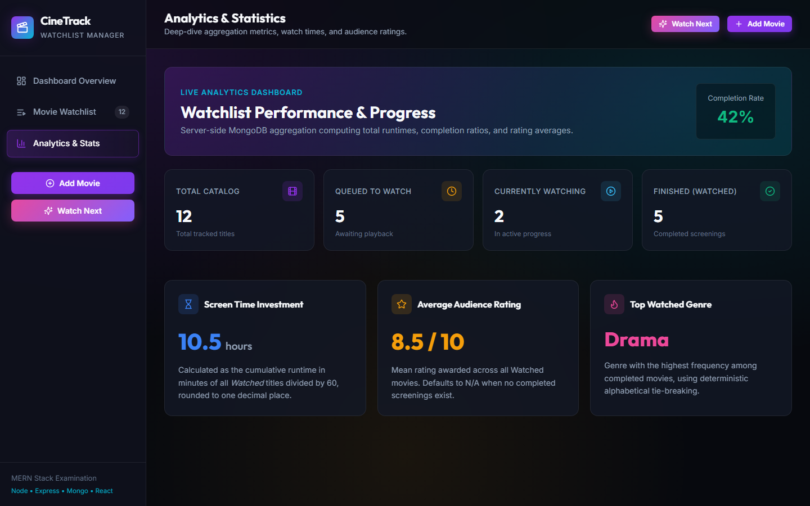

# CineTrack &mdash; MERN Movie Watchlist Manager

[](https://nodejs.org/)
[](https://opensource.org/licenses/MIT)
[]()
[]()

> A production-grade, original, full-stack Movie Watchlist Manager built for the Full Stack Development exit examination. Designed with a dark cinematic visual identity, MongoDB Atlas persistent data storage, atomic per-year movie code indexing, strict status transition workflow rules, live server-side aggregation analytics, and an intelligent recommendation engine.

---

## Application Screenshots

### 1. Dashboard Overview & Active Watchlist


### 2. Live Watchlist & Pagination


### 3. Intelligent "Watch Next" Recommendation Engine


### 4. Deep-Dive Analytics & Aggregated Statistics


---

## Main Features

1. **Year-Specific Atomic Movie Code Generation**:
   - Movie Codes follow the required format: `MV-YYYY-NNN` (e.g., `MV-2024-001`, `MV-2024-002`, `MV-2019-001`).
   - The sequence is maintained independently per release year using an atomic MongoDB `counters` collection with `findOneAndUpdate` and `$inc`.
   - Sequence numbers never decrement or get reused when records are deleted.
   - Movie Codes are protected; clients cannot supply or overwrite them.

2. **Case-Insensitive Duplicate Prevention (HTTP 409)**:
   - Enforces unique `(title, releaseYear)` combinations, ignoring casing and surrounding whitespace.
   - A normalized title index `{ titleNormalized: 1, releaseYear: 1 }` guarantees database-level integrity.
   - When conflicts occur, the server returns HTTP 409 Conflict with descriptive messages, preserved without clearing form fields.

3. **Strict Workflow State Transitions**:
   - `To Watch` &rarr; `Watching`
   - `To Watch` &rarr; `Watched`
   - `Watching` &rarr; `Watched`
   - `Watching` &rarr; `To Watch`
   - `Watched` &rarr; **Final status** (no further status changes allowed).
   - Attempting illegal status transitions returns HTTP 400 with a detailed error.

4. **Mandatory Ratings for Watched Movies**:
   - Moving any title into `Watched` requires a numerical rating from 1 to 10.
   - The current server timestamp is automatically persisted as `watchedDate`.
   - Titles in `To Watch` or `Watching` status cannot hold ratings.
   - Existing `Watched` movies can have their ratings updated without altering their status.

5. **Guarded Deletion Rules**:
   - Movies in `Watching` status **cannot be deleted**. The server returns HTTP 400.
   - The frontend UI displays a clear explanation and disables the delete button.
   - Movies in `To Watch` or `Watched` require an interactive confirmation dialog before deletion.

6. **Intelligent "What Should I Watch Next?" Recommendation Engine**:
   - Prominent interactive trigger on both topbar and overview banner.
   - Backend queries the `To Watch` queue deterministically:
     1. Highest **Priority** (5 down to 1)
     2. Shortest **Runtime** as tie-breaker
     3. Movie Code ascending as secondary tie-breaker
   - Returns HTTP 404 with a helpful message if the queue is empty.
   - Allows users to transition immediately from recommendation to `Watching`.

7. **Server-Side Live Analytics Dashboard**:
   - Live MongoDB aggregation pipeline computing:
     - Total titles in catalog
     - Per-status counts (`To Watch`, `Watching`, `Watched`)
     - Total hours watched (`sum(runtime) / 60`, rounded to 1 decimal place)
     - Average audience rating of completed movies (rounded to 1 decimal place, or `N/A`)
     - Most-watched genre with alphabetical tie-breaking (or `N/A`)
   - Auto-refreshes after every creation, update, status change, rating edit, and deletion.

8. **Search, Filtering, and Pagination**:
   - Case-insensitive title search.
   - Status filtering (`All`, `To Watch`, `Watching`, `Watched`).
   - Genre filtering across 7 genres.
   - Strict pagination with **exactly 6 movies per page**.

---

## Technologies Used

| Domain | Technologies |
|---|---|
| **Frontend** | React 18, Vite 6, Modern Vanilla CSS, Lucide React Icons |
| **Backend** | Node.js, Express.js, Helmet, CORS, Morgan, express-validator |
| **Database** | MongoDB Atlas, Mongoose ODM |
| **Testing** | Node.js Test Runner (`node:test`, `node:assert`), Supertest |
| **Deployment** | Render (Web Service for Backend, Static Site for Frontend), `render.yaml` |

---

## Project Structure

```
assesment/
├── frontend/
│   ├── public/
│   ├── src/
│   │   ├── api/
│   │   │   └── movieApi.js              # Centralized API client (fetch)
│   │   ├── components/
│   │   │   ├── AddMovieModal.jsx        # Dual-validated movie creation modal
│   │   │   ├── DeleteConfirmModal.jsx   # Deletion confirmation with Watching guard
│   │   │   ├── EditMovieModal.jsx       # Edit allowed fields only
│   │   │   ├── MovieCard.jsx            # Card with badges, stars & quick actions
│   │   │   ├── MovieDetailsModal.jsx    # Full metadata display modal
│   │   │   ├── Pagination.jsx           # 6-per-page pagination controls
│   │   │   ├── RatingModal.jsx          # Watched rating editor
│   │   │   ├── Sidebar.jsx              # Responsive navigation sidebar
│   │   │   ├── StatsOverview.jsx        # Top-level live 7-metric stats cards
│   │   │   ├── StatusChangeModal.jsx    # Workflow transition modal
│   │   │   ├── Toast.jsx                # Toast notification system
│   │   │   ├── Toolbar.jsx              # Search, status tabs, and genre select
│   │   │   ├── WatchNextBanner.jsx      # Curated decision engine banner
│   │   │   └── WatchNextModal.jsx       # Recommendation presentation modal
│   │   ├── pages/
│   │   │   └── StatisticsPage.jsx       # Deep-dive analytics dashboard page
│   │   ├── styles/
│   │   │   └── index.css                # Cinematic dark theme & design system
│   │   ├── utils/
│   │   │   └── constants.js             # Shared frontend constants
│   │   ├── App.jsx                      # Main React application
│   │   └── main.jsx                     # Vite React root
│   ├── .env.example                     # Frontend environment template
│   ├── index.html                       # HTML5 entry with Outfit & Inter typography
│   ├── package.json                     # Frontend scripts & dependencies
│   ├── README.md                        # Frontend documentation
│   └── vite.config.js                   # Vite dev/build configuration
├── backend/
│   ├── config/
│   │   └── db.js                        # MongoDB Atlas connection handler
│   ├── controllers/
│   │   ├── movieController.js           # REST controller for movies
│   │   └── statsController.js           # REST controller for analytics
│   ├── middleware/
│   │   ├── errorHandler.js              # Centralized duplicate (11000) & error handler
│   │   └── validator.js                 # Express-validator middleware
│   ├── models/
│   │   ├── Counter.js                   # Atomic sequence counter per year
│   │   └── Movie.js                     # Movie Mongoose schema & indexes
│   ├── routes/
│   │   ├── movieRoutes.js               # Movies API routing (/watch-next before /:id)
│   │   └── statsRoutes.js               # Statistics API routing
│   ├── services/
│   │   ├── codeGeneratorService.js      # Per-year atomic code generator
│   │   ├── movieService.js              # Business logic & workflow rules
│   │   └── statsService.js              # MongoDB aggregation analytics service
│   ├── tests/
│   │   ├── e2e-verification.js          # Live end-to-end integration verification
│   │   └── movie.test.js                # Automated integration test suite
│   ├── utils/
│   │   ├── apiResponse.js               # Standard JSON response wrappers
│   │   ├── constants.js                 # Business constraints, genres, platforms
│   │   └── seed.js                      # Optional database seeder
│   ├── .env.example                     # Backend environment template
│   ├── package.json                     # Backend scripts & dependencies
│   ├── README.md                        # Backend documentation
│   └── server.js                        # Express server entrypoint
├── screenshots/
│   ├── dashboard_overview.png           # Genuine screenshot of dashboard
│   ├── dashboard_watchlist.png          # Genuine screenshot of watchlist
│   ├── recommendation_modal.png         # Genuine screenshot of recommendation
│   └── statistics_dashboard.png         # Genuine screenshot of statistics
├── .env.example                         # Root environment template
├── .gitignore                           # Git ignore rules (.env, node_modules)
├── render.yaml                          # Render Blueprint infrastructure spec
└── README.md                            # Complete root documentation
```

---

## Prerequisites

- **Node.js**: `v18.0.0` or higher (tested on Node.js `v24`)
- **NPM**: `v9.0.0` or higher
- **MongoDB Atlas**: A free or paid cluster with connection URI

---

## Local Installation & Setup

### 1. Clone the Repository
```bash
git clone https://github.com/jovilin225501/assesment.git
cd assesment
```

### 2. Configure Environment Variables

Create `.env` inside `backend/`:
```bash
# backend/.env
PORT=5000
NODE_ENV=development
MONGODB_URI=mongodb+srv://<username>:<password>@<cluster-host>/movie_watchlist?retryWrites=true&w=majority
FRONTEND_URL=http://localhost:5173
```

Create `.env` inside `frontend/`:
```bash
# frontend/.env
VITE_API_BASE_URL=http://localhost:5000/api
```

> **Security Note**: Never commit actual database passwords or production credentials to Git. Real credentials should only reside in your untracked `.env` files or Render dashboard settings.

### 3. Install Dependencies
```bash
# Install backend packages
cd backend
npm install

# Install frontend packages
cd ../frontend
npm install
```

### 4. Seed Diverse Sample Data (Optional & Safe)
```bash
cd ../backend
npm run seed
```
This populates 12 original, diverse titles spanning 2016&ndash;2024 across all genres, platforms, and statuses with valid Movie Codes (`MV-2024-001`, `MV-2024-002`, etc.).

---

## Running the Application

Open two separate terminals:

### Terminal 1: Backend Server
```bash
cd backend
npm run dev
# Server will listen on http://localhost:5000
```

### Terminal 2: Frontend Client
```bash
cd frontend
npm run dev
# Vite will serve on http://localhost:5173
```

Visit **`http://localhost:5173`** in your browser.

---

## Running Automated Tests

```bash
cd backend
npm test
```

This runs the automated suite covering duplicate rejection, year/runtime bounds, workflow status rules, deletion locks, Watch Next algorithms, and statistics aggregations.

To run the live HTTP end-to-end test against a running backend:
```bash
node backend/tests/e2e-verification.js
```

---

## Complete REST API Documentation

Base URL: `/api`

### 1. System Health Check
- **Endpoint**: `GET /api/health`
- **Response `200 OK`**:
```json
{
  "success": true,
  "message": "Movie Watchlist API is healthy",
  "data": {
    "uptime": 128.4,
    "timestamp": "2026-10-28T08:30:00.000Z",
    "database": "connected"
  }
}
```

### 2. List Movies (with Search, Filter & Pagination)
- **Endpoint**: `GET /api/movies?page=1&limit=6&status=To%20Watch&genre=Sci-Fi&search=chrono`
- **Query Parameters**:
  - `page` (number, default: `1`)
  - `limit` (number, default: `6`)
  - `status` (`To Watch` | `Watching` | `Watched`)
  - `genre` (`Action` | `Comedy` | `Drama` | `Horror` | `Sci-Fi` | `Romance` | `Thriller`)
  - `search` (case-insensitive title search)
- **Response `200 OK`**:
```json
{
  "success": true,
  "message": "Movies retrieved successfully",
  "data": [
    {
      "_id": "6ae1ae16a8940aa176111dce",
      "movieCode": "MV-2024-001",
      "title": "The Chrono Paradox",
      "genre": "Sci-Fi",
      "releaseYear": 2024,
      "runtime": 142,
      "platform": "Netflix",
      "priority": 5,
      "status": "To Watch",
      "rating": null,
      "watchedDate": null,
      "createdAt": "2026-10-28T08:10:00.000Z",
      "updatedAt": "2026-10-28T08:10:00.000Z"
    }
  ],
  "pagination": {
    "totalMovies": 1,
    "currentPage": 1,
    "pageSize": 6,
    "totalPages": 1,
    "hasPrevPage": false,
    "hasNextPage": false
  }
}
```

### 3. Add Movie
- **Endpoint**: `POST /api/movies`
- **Request Body**:
```json
{
  "title": "Solaris Horizon",
  "genre": "Sci-Fi",
  "releaseYear": 2025,
  "runtime": 138,
  "platform": "Netflix",
  "priority": 4
}
```
- **Response `201 Created`**:
```json
{
  "success": true,
  "message": "Movie successfully added to watchlist",
  "data": {
    "movieCode": "MV-2025-001",
    "title": "Solaris Horizon",
    "genre": "Sci-Fi",
    "releaseYear": 2025,
    "runtime": 138,
    "platform": "Netflix",
    "priority": 4,
    "status": "To Watch",
    "rating": null,
    "watchedDate": null
  }
}
```
- **Error Response `409 Conflict` (Duplicate Movie)**:
```json
{
  "success": false,
  "message": "A movie with title \"Solaris Horizon\" and release year 2025 already exists."
}
```

### 4. Watch Next Recommendation
- **Endpoint**: `GET /api/movies/watch-next`
- **Response `200 OK`**:
```json
{
  "success": true,
  "message": "Next movie recommendation found",
  "data": {
    "movieCode": "MV-2024-002",
    "title": "Neon Odyssey",
    "priority": 5,
    "runtime": 110,
    "status": "To Watch"
  }
}
```
- **Error Response `404 Not Found` (Queue Empty)**:
```json
{
  "success": false,
  "message": "No movies currently in your \"To Watch\" list. Add some movies to receive recommendations!"
}
```

### 5. Update Allowed Fields
- **Endpoint**: `PUT /api/movies/:id`
- **Allowed Fields**: `title`, `genre`, `runtime`, `platform`, `priority`
- **Protected Fields** (Ignored/Forbidden): `movieCode`, `releaseYear`, `watchedDate`, `status`, `rating`
- **Response `200 OK`**:
```json
{
  "success": true,
  "message": "Movie updated successfully",
  "data": { ... }
}
```

### 6. Transition Movie Status
- **Endpoint**: `PATCH /api/movies/:id/status`
- **Request Body (To Watched)**:
```json
{
  "status": "Watched",
  "rating": 8.5
}
```
- **Response `200 OK`**:
```json
{
  "success": true,
  "message": "Movie status changed to \"Watched\" successfully",
  "data": {
    "status": "Watched",
    "rating": 8.5,
    "watchedDate": "2026-10-28T08:25:00.000Z"
  }
}
```

### 7. Update Rating (Watched Movies Only)
- **Endpoint**: `PATCH /api/movies/:id/rating`
- **Request Body**:
```json
{
  "rating": 9.0
}
```
- **Response `200 OK`**:
```json
{
  "success": true,
  "message": "Movie rating updated successfully",
  "data": { ... }
}
```

### 8. Delete Movie
- **Endpoint**: `DELETE /api/movies/:id`
- **Response `200 OK`** (for `To Watch` or `Watched`):
```json
{
  "success": true,
  "message": "Movie \"The Silent Cellist\" successfully deleted"
}
```
- **Error Response `400 Bad Request`** (if movie is in `Watching` status):
```json
{
  "success": false,
  "message": "A movie in \"Watching\" status cannot be deleted. Please transition the movie to \"To Watch\" or \"Watched\" before deletion."
}
```

### 9. Dashboard Statistics
- **Endpoint**: `GET /api/stats`
- **Response `200 OK`**:
```json
{
  "success": true,
  "message": "Watchlist statistics retrieved successfully",
  "data": {
    "totalMovies": 12,
    "toWatchCount": 5,
    "watchingCount": 2,
    "watchedCount": 5,
    "totalHoursWatched": 10.5,
    "averageRating": "8.5",
    "mostWatchedGenre": "Drama"
  }
}
```

---

## Render Deployment Guide

The application is structured for instant deployment on [Render](https://render.com) using the included `render.yaml` blueprint or manual setup.

### Architecture on Render
1. **Backend Web Service**: Node.js environment running `server.js`.
2. **Frontend Static Site**: Vite build outputting to `dist/` with client-side SPA rewrite rules.

### Option A: Automatic Blueprint Deployment
1. Connect your GitHub repository `https://github.com/jovilin225501/assesment` to Render.
2. In the Render Dashboard, select **New &rarr; Blueprint**.
3. Point to `render.yaml`.
4. Supply the secret `MONGODB_URI` environment variable when prompted.

### Option B: Manual Service Configuration

#### 1. Backend Web Service:
- **Name**: `movie-watchlist-backend`
- **Root Directory**: `backend`
- **Environment**: `Node`
- **Build Command**: `npm install`
- **Start Command**: `npm start`
- **Health Check Path**: `/api/health`
- **Environment Variables**:
  - `NODE_ENV`: `production`
  - `PORT`: `5000`
  - `MONGODB_URI`: `mongodb+srv://<username>:<password>@<cluster-host>/movie_watchlist?retryWrites=true&w=majority`
  - `FRONTEND_URL`: `https://movie-watchlist-frontend.onrender.com`

#### 2. Frontend Static Site:
- **Name**: `movie-watchlist-frontend`
- **Root Directory**: `frontend`
- **Build Command**: `npm install && npm run build`
- **Publish Directory**: `dist`
- **Rewrite Rules**: Source: `/*` &rarr; Destination: `/index.html`
- **Environment Variables**:
  - `VITE_API_BASE_URL`: `https://movie-watchlist-backend.onrender.com/api`

---

## Verification & Business Rules Checklist

- [x] **Add valid movie**: Auto-generates `MV-YYYY-XXX` sequence and sets default `To Watch` status.
- [x] **Validation bounds**: Enforces integer Release Year between 1950 and current year, and Runtime between 30 and 300 minutes.
- [x] **Duplicate check**: Enforces unique normalized title and release year, responding with HTTP 409 Conflict.
- [x] **Pagination**: Exactly 6 cards per page with deterministic priority and runtime ordering.
- [x] **Status workflow**:
  - `To Watch` &rarr; `Watching` &rarr; `Watched`
  - `Watching` &rarr; `To Watch`
  - `Watched` terminal status rejects all transitions with HTTP 400.
- [x] **Mandatory rating**: Moving to `Watched` requires a 1&ndash;10 rating and sets `watchedDate`.
- [x] **Delete restrictions**: Deletion of `Watching` movies is blocked by backend (HTTP 400) and disabled in the UI.
- [x] **Watch Next**: Recommends highest priority title, tie-broken by shortest runtime, or returns 404 when queue is empty.
- [x] **Live statistics**: Aggregates total movies, queue counts, total hours, average rating, and top genre.
- [x] **Genuine screenshots**: Captured live from running application in `screenshots/`.

---

## Attribution & License

- UI Icons: [Lucide Icons](https://lucide.dev/) (ISC License)
- Typography: [Google Fonts](https://fonts.google.com/) (Inter & Outfit &mdash; SIL Open Font License)
- Project Code: MIT License &copy; 2026 jovilin225501
